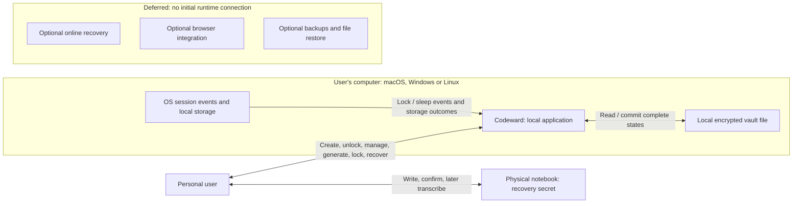
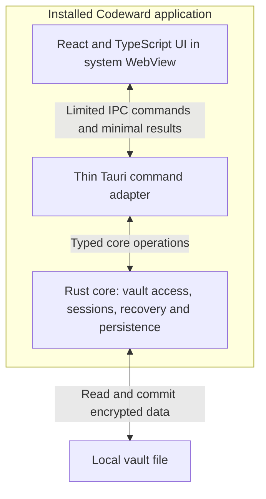
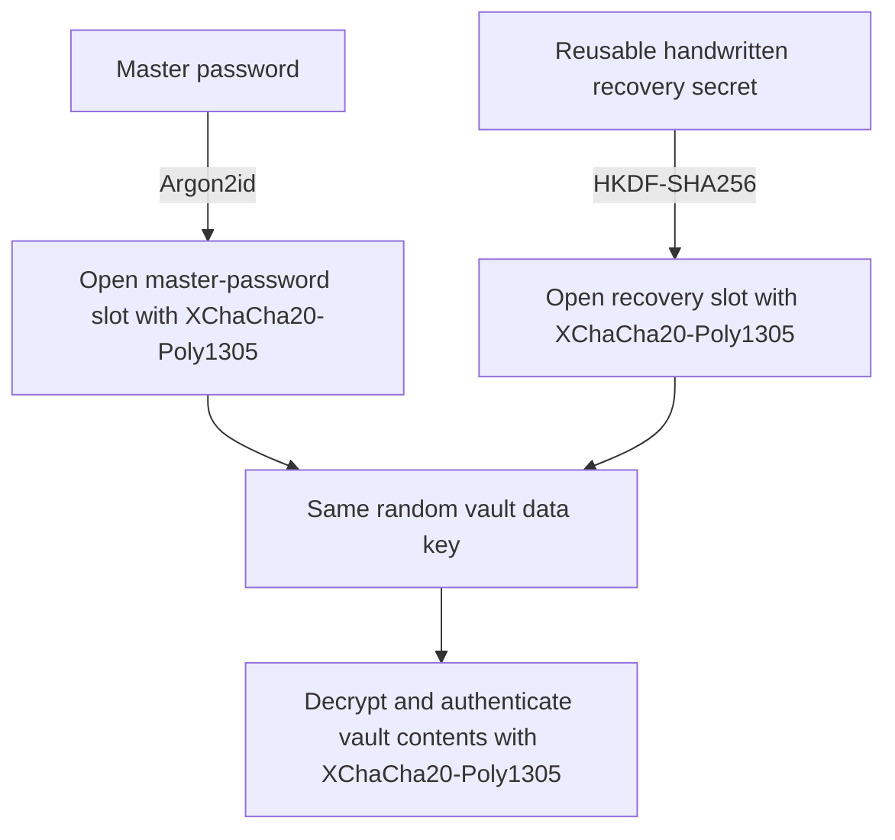
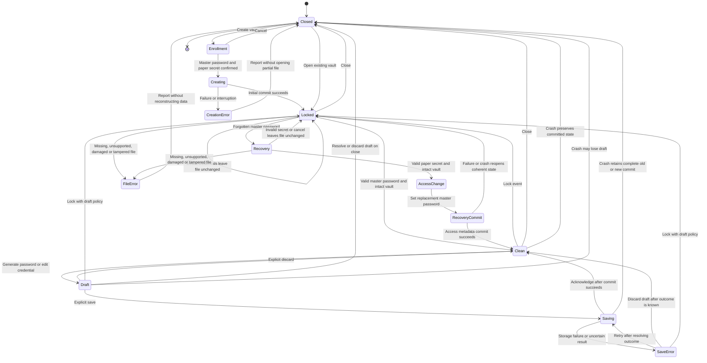

# System design

Status: logical design with owner-selected Rust core, Tauri host, React/TypeScript
UI, installed desktop delivery, and macOS/Windows/Linux targets. The IPC topology
is selected, along with Argon2id, HKDF-SHA256 and XChaCha20-Poly1305 from RustCrypto.
The owner selected a binary envelope with one encrypted JSON snapshot and a starting
parameter profile in ADR-0002. Exact byte layout, protocol schema and package
versions remain open. There is no KeePassXC format-compatibility commitment.

## System context

The paper secret reaches the app through explicit enrollment display/user entry.
The notebook is outside the computer boundary. Initial runtime has no required service
or network communication. Isolated future boxes describe scope, not approved APIs.

## Logical responsibilities

| Responsibility | Contract |
| --- | --- |
| User interaction | Display lock/save state, collect intent, explain recovery limits |
| Session control | Gate locked access, enforce triggers, handle drafts explicitly |
| Credential operations | Manage records/generation, distinguish drafts from commits |
| Vault access/recovery | Validate input, authenticate, protect contents, manage access metadata |
| Persistence | Commit complete states safely, preserve prior state on failure, report outcomes |

The Rust core owns session control, credential operations, vault access/recovery,
and persistence. React owns presentation, and a thin Tauri adapter connects IPC to
core operations. Exact security components/format bytes, commit mechanism and detailed
session policies still require ADR review. See the [UI/core contract](ui-core-contract.md).

## Installed application separation

The same logical separation applies on all three desktop target families. The UI
collects intent and displays results; the Rust core validates each request, gates
actions on session state, and reports committed outcomes. The UI does not read or
write the vault directly or hold the core's session keys. Authorized display of a
credential can expose transient plaintext in the UI; minimize that exposure and
define lock/redaction behavior in ADR-0005. Separation does not imply perfect
memory erasure, process isolation, or protection against a compromised OS.

The installed app bundles its interface assets and opens its own window. Users
do not start a localhost server or open a browser tab; no runtime network service
is required. Tauri/React is selected. Keep Tauri and React details out of the core's
application operations so those contracts can be tested independently. The adapter
passes trusted caller context; the Rust core still validates each operation.

Command/data limits, secret exposure, notification payloads, stale-reply rejection,
and permission requirements are defined in [ui-core-contract.md](ui-core-contract.md).

Platform-specific filesystem, session-event, and packaging adapters need validation.
Keep platform assumptions outside the shared vault behavior and define a bounded
Linux distribution/desktop matrix before claiming support.

## Vault key and unlock slots

Each slot stores a separately protected copy of the same per-vault data key.
Either valid secret can unlock its slot without the other secret. The file holds
encrypted contents, both protected slots and required public metadata, not the
plaintext secrets or unwrapped data key. Rust performs key derivation, unwrapping
and content validation; React receives only permitted interaction data.

Recovery permits setting a replacement master-password slot without exposing the
forgotten password. Updating a slot does not itself rotate the data key or revoke
old vault copies. Protecting future contents after data-key compromise requires a
reviewed rotation strategy. Missing/corrupted files still need separate file recovery.

The owner-selected [ADR-0002](adr/0002-vault-security-and-format.md) construction uses
a versioned binary envelope, two key slots and one encrypted UTF-8 JSON snapshot.
Each slot authenticates its own role/derivation metadata, excluding the other slot
and changing revision; the payload authenticates the complete public header with
both encrypted slots. A slot change requires payload re-encryption with a fresh
nonce. Credential titles, URLs, notes, timestamps and internal IDs are encrypted.
File size, public crypto parameters and the stable vault ID remain exposed.

The starting Argon2id profile is 64 MiB, 3 passes and 4 lanes; the entire file is
limited to 16 MiB. Version 1 excludes attachments, compression, per-record encryption
and append-only history. Exact envelope/AAD bytes, schema, parser sublimits,
dependency review and measurements remain open. The 256-bit reusable paper secret,
52-character Base32 representation plus checksum and remaining lifecycle decisions
are in [ADR-0004](adr/0004-offline-recovery.md). These are design choices, not working code.

## Vault lifecycle

`Clean` and `Draft` are unlocked. `AccessChange` and `RecoveryCommit` are restricted
recovery states, not credential browsing. Recovery requires validation of the file;
invalid files never unlock. Announce recovery success only after new access commits.

The diagram summarizes outcomes, not an implementation. A crash in any transient
state leads next launch through closed/locked access. Creation may leave no ready
vault; updates must retain a complete prior or new commit. Normal saves and access
changes share the commit contract. After interrupted acknowledgement, inspect the
actual committed file on reopen.

Lock/close with drafts requires an explicit policy in ADR-0005; these transitions
do not authorize silent autosave or promise draft retention. If locking occurs
during a save/recovery commit, hide credentials while resolving the commit
coherently. Never postpone a security lock indefinitely for an edit or mislabel
an interrupted operation as saved.

## Persistence invariants

1. Save acknowledgement refers to a complete committed state.
2. Failed/interrupted updates cannot replace the last good state with partial data.
3. A crash after commit but before acknowledgement may leave the new complete state.
4. Credential contents and access/recovery metadata remain mutually consistent.
5. Drafts have no durability promise; displaying/copying does not commit them.
6. Conflicting writers must not silently overwrite each other.

Operations, durability, temporary files, writer exclusion, and power-loss
assumptions remain in [ADR-0003](adr/0003-committed-writes.md). Neither a recovery
secret nor a save protocol reconstructs the only missing vault file.
