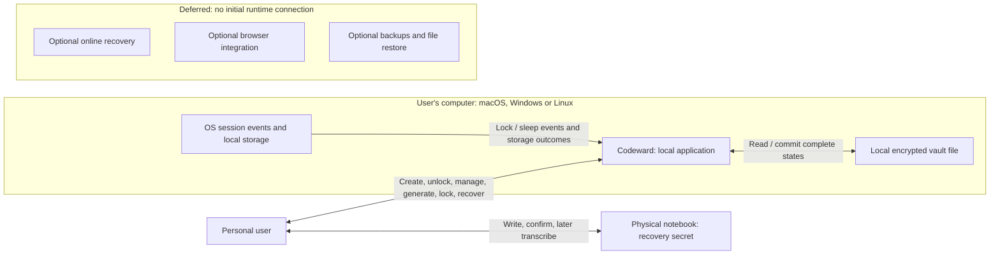
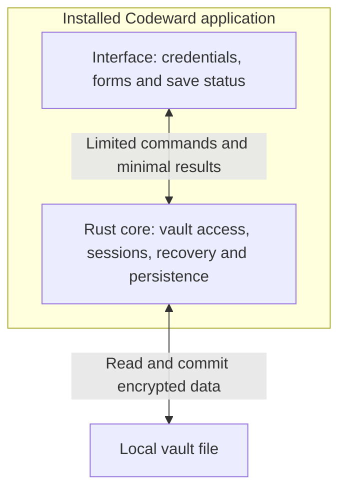
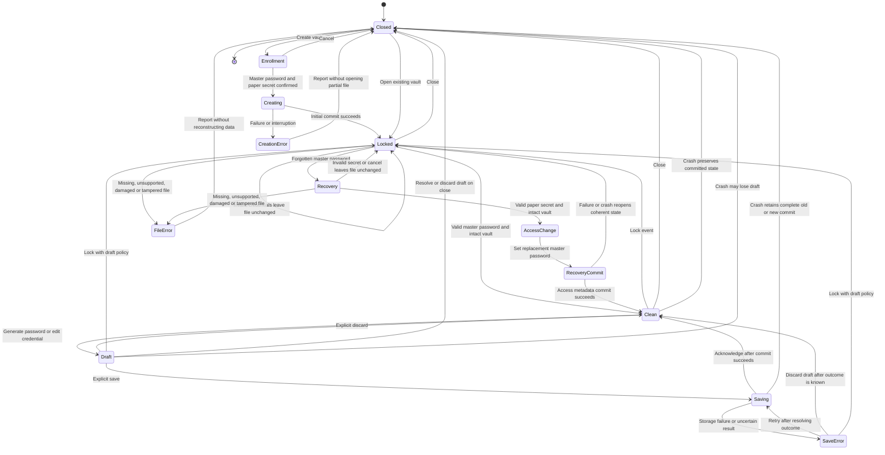

# System design

Status: logical design with owner-confirmed Rust core, installed desktop delivery,
and macOS/Windows/Linux targets. Boxes describe responsibilities, not a selected
UI toolkit, process model, file layout, or algorithm. There is no KeePassXC
format-compatibility or identical-internals commitment.

## System context

The paper secret reaches the app through explicit enrollment display/user entry.
The notebook is outside the computer boundary. Initial runtime has no required service
or network communication. Isolated future boxes describe scope, not approved APIs.

## Logical responsibilities

| Responsibility | Contract |
| --- | --- |
| User interaction | Display lock/save state, collect intent, explain recovery limits |
| Session control | Gate locked access, enforce triggers, handle drafts explicitly |
| Credential operations | Manage records/generation, distinguish drafts from commits |
| Vault access/recovery | Validate input, authenticate, protect contents, manage access metadata |
| Persistence | Commit complete states safely, preserve prior state on failure, report outcomes |

The Rust core owns session control, credential operations, vault access/recovery,
and persistence. UI toolkit, security components, file format, and commit mechanism
still require ADR review.

## Installed application separation

The same logical separation applies on all three desktop target families. The UI
collects intent and displays results; the Rust core validates each request, gates
actions on session state, and reports committed outcomes. The UI does not read or
write the vault directly or hold the core's session keys. Authorized display of a
credential can expose transient plaintext in the UI; minimize that exposure and
define lock/redaction behavior in ADR-0005. Separation does not imply perfect
memory erasure, process isolation, or protection against a compromised OS.

The installed app bundles its interface assets and opens its own window. Users
do not start a localhost server or open a browser tab; no runtime network service
is required. Tauri with TypeScript/React remains a recommendation. The command
boundary may become an in-process API or IPC depending on that later UI decision.

Platform-specific filesystem, session-event, and packaging adapters need validation.
Keep platform assumptions outside the shared vault behavior and define a bounded
Linux distribution/desktop matrix before claiming support.

## Vault lifecycle

`Clean` and `Draft` are unlocked. `AccessChange` and `RecoveryCommit` are restricted
recovery states, not credential browsing. Recovery requires validation of the file;
invalid files never unlock. Announce recovery success only after new access commits.

The diagram summarizes outcomes, not an implementation. A crash in any transient
state leads next launch through closed/locked access. Creation may leave no ready
vault; updates must retain a complete prior or new commit. Normal saves and access
changes share the commit contract. After interrupted acknowledgement, inspect the
actual committed file on reopen.

Lock/close with drafts requires an explicit policy in ADR-0005; these transitions
do not authorize silent autosave or promise draft retention. If locking occurs
during a save/recovery commit, hide credentials while resolving the commit
coherently. Never postpone a security lock indefinitely for an edit or mislabel
an interrupted operation as saved.

## Persistence invariants

1. Save acknowledgement refers to a complete committed state.
2. Failed/interrupted updates cannot replace the last good state with partial data.
3. A crash after commit but before acknowledgement may leave the new complete state.
4. Credential contents and access/recovery metadata remain mutually consistent.
5. Drafts have no durability promise; displaying/copying does not commit them.
6. Conflicting writers must not silently overwrite each other.

Operations, durability, temporary files, writer exclusion, and power-loss
assumptions remain in [ADR-0003](adr/0003-committed-writes.md). Neither a recovery
secret nor a save protocol reconstructs the only missing vault file.
